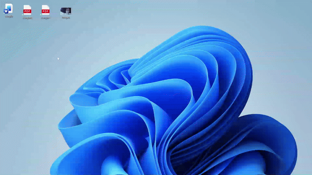

<div align="center">


# Morph

**Convert and edit files from a radial menu, on Windows and Linux.**
Press a shortcut, drop files on the orb, pick what to do. Everything runs on your computer.

[Download](https://github.com/itsofficially-sreyash/Morph/releases/latest) ·
[What it can do](#what-it-can-do) ·
[Build from source](#build-from-source) ·
[Contributing](CONTRIBUTING.md)

</div>

<div align="center">

<a href="docs/morph_intro.mp4"></a>

<sub>Click the animation to watch the full video with sound.</sub>

</div>

## How it works

1. Press **Ctrl + Shift + Space**. The orb opens at your mouse.
2. Drag files onto it: photos, videos, songs, PDFs or documents, even a mix.
3. Pick an action from the ring. The result is saved **next to the original**, named like
   `photo.converted.png`.

You can also right-click files and choose **Convert with Morph**.

## What it can do

| Files | Actions |
|---|---|
| **Images**: PNG, JPG, WEBP, AVIF, HEIC/HEIF (iPhone photos), BMP, TIFF, GIF, ICO | Convert to PNG, JPG, WEBP or AVIF · Resize (by size or %) · Crop (draw a box) · Shrink · Put several images into one PDF |
| **Video**: MP4, MKV, WEBM, MOV, AVI, M4V, WMV | Convert to MP4, WEBM or GIF · Shrink · Extract the soundtrack · Mute |
| **Audio**: MP3, WAV, FLAC, OGG, M4A, OPUS, AAC, WMA | Convert to MP3, WAV, FLAC or M4A · Even out the loudness |
| **PDF** | Merge (in the order you choose) · Split (every page, or ranges like `1-3, 5`) · Shrink · Save pages as images · Rotate |
| **Documents**: DOCX, DOC, ODT, RTF, TXT, PPTX, PPT, ODP, XLSX, XLS, ODS | Save as PDF · Text documents also as DOCX, ODT or TXT |

Documents use the office suite you already have: Microsoft Office on Windows, or LibreOffice
(Windows or Linux). Everything else works out of the box.

## Private and light

- **Nothing is uploaded.** No account and no telemetry. The only time Morph goes online is a quick
  check for a new version when it starts, which you can turn off in Settings. Updates are signed,
  and installed only when you say so.
- **Never overwrites your files** without asking.
- **Barely there when idle:** on Windows, about 2 MB of memory and no CPU while it waits in the
  tray. Conversions run at low priority, so your computer stays responsive.

## Download

Get the latest version from the [Releases page](https://github.com/itsofficially-sreyash/Morph/releases/latest).

| System | File | How to install |
|---|---|---|
| **Windows 10 / 11** (64-bit) | `Morph_x.y.z_x64-setup.exe` | Double-click and follow the setup. No admin rights needed. |
| **Ubuntu, Debian, Linux Mint** | `Morph_x.y.z_amd64.deb` | Double-click; it opens in the software centre. |
| **Fedora, openSUSE** | `Morph-x.y.z-1.x86_64.rpm` | Double-click; it opens in the software centre. |
| **Any other Linux** | `Morph_x.y.z_amd64.AppImage` | Right-click → Properties → allow running as a program, then double-click. |

**Windows may show "Windows protected your PC"** because Morph isn't code-signed yet. Click
**More info → Run anyway**.

**Uninstalling:** on Windows (Settings → Apps), this also removes the right-click entry and
start-at-sign-in. On Linux (your software centre, or deleting the AppImage), those entries stay
in your home folder but switch themselves off once Morph is gone. To remove them all first,
including the GNOME shortcut, run `morph --remove-integration` before uninstalling.

<details>
<summary>Notes for Linux</summary>

- **Shortcut on Wayland:** on GNOME, Morph adds its shortcut to Settings → Keyboard → Custom
  Shortcuts for you. On other Wayland desktops, add a custom shortcut that runs `morph --toggle`.
- **Right-click entry:** Files (Nautilus) shows it under **Scripts**. Nemo, Dolphin and Thunar
  show it directly.
- **PDF pages to images** needs `pdftoppm` (`sudo apt install poppler-utils`), and documents need
  LibreOffice.
- **AppImage won't start?** AppImages need FUSE 2: `sudo apt install libfuse2t64` on Ubuntu 24.04
  (`libfuse2` on older releases).

</details>

## Build from source

You need [Rust](https://rustup.rs), [Node.js](https://nodejs.org) 20 or newer, and the
[Tauri prerequisites](https://tauri.app/start/prerequisites/) for your system.

```bash
git clone https://github.com/itsofficially-sreyash/Morph.git
cd Morph
npm install
npm run tauri dev         # run it
cd src-tauri && cargo test  # run the tests
```

Development builds use the FFmpeg on your PATH, if you have one. For the installers, fetch the
bundled LGPL FFmpeg first and build with the release config:

```bash
node scripts/fetch-ffmpeg.mjs
npm run tauri build -- --config src-tauri/tauri.release.conf.json
```

Pushing a `v*` tag builds the Windows and Linux installers on GitHub Actions
([release.yml](.github/workflows/release.yml)).

## Licence

Morph is free software under the [GNU GPL v3.0 or later](LICENSE). The installers include an
LGPL build of FFmpeg; see [THIRD_PARTY.md](THIRD_PARTY.md).
